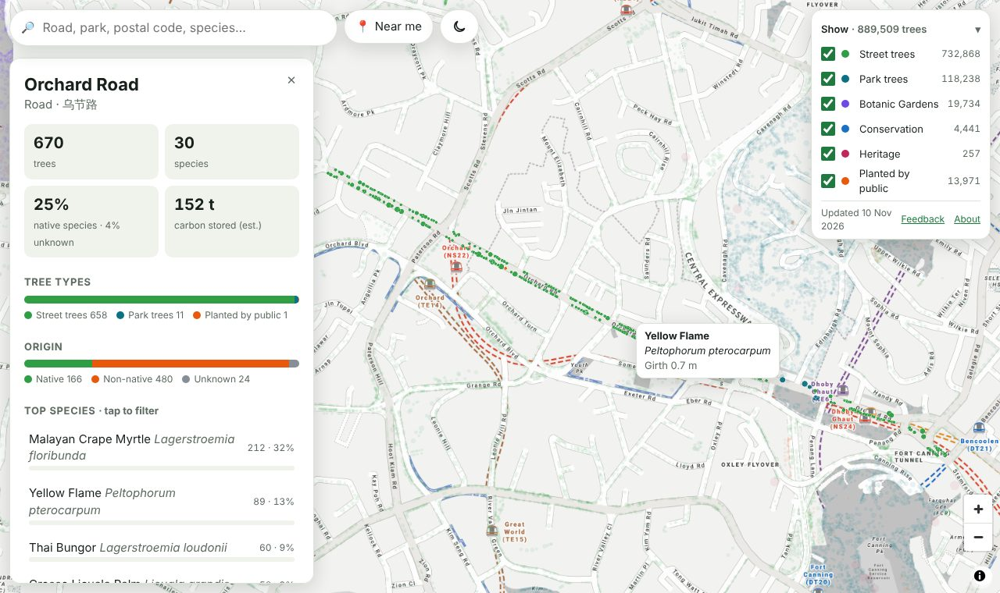

# 🌳 TreeNerd

**[treenerd.fyi](https://treenerd.fyi)**: explore every tree in Singapore.

TreeNerd maps Singapore's ~890,000 trees and makes them searchable by **road**, **park**, **planning area**, **subzone**, **park connector**, **constituency**, **MRT station**, **address** or **species**. Pick a place to see how many trees it has, which species dominate, how much carbon they store, and its largest trees. Pick any tree to see its details.



## Principles

Every build must meet three requirements, in this order: **accuracy**, a good **iPhone and iPad experience**, and **reliability**. They're defined, with the checks that enforce them, in [PRINCIPLES.md](PRINCIPLES.md).

## Features

- **Forgiving search**: typos and abbreviations work ("orchad rd", "upp thomson", "jln kayu"), and species match by common, scientific, Chinese and Malay names.
- **Address and station search**: postal codes, HDB blocks, building names and MRT/LRT stations show the trees within 100–500 m.
- **Place summaries**: tree and species counts, share of native species, estimated carbon, heritage trees, and top species (tap one to filter the map). Each summary lists its largest trees and offers a CSV download.
- **Tree cards**: species, girth, height, age, estimated carbon, and the road, park, area and constituency the tree is in. Heritage trees include their story.
- **Trees near me**, using your location, or anywhere: press and hold the map on a phone or tablet, or right-click on a computer.
- **Rankings**: the roads, parks and areas with the most trees, species or stored carbon, and the widest trunks. Tap the empty search box to find them.
- **Recent changes**: trees added to, or no longer in, NParks' records, for each place and for the whole island.
- **Made for phones**: a resizable bottom sheet and large tap targets. It can be installed to the home screen.
- **Light and dark themes**: follows your device by default and can be switched from the map.
- **Shareable links** for every view, with rich previews in messaging apps. The browser's Back button steps through what you opened.

## Links

Every view has its own URL:

| URL | Opens |
|---|---|
| `/?p=road/orchard-road` | A place. Kinds: `road`, `park`, `subzone`, `planning_area`, `pcn`, `constituency`, `heritage_road` |
| `/?s=3106` | A species |
| `/?t=12561254` | A single tree |
| `/?near=1.3039,103.8359,150` | Trees within 150 m of a point (radius 100, 150, 250 or 500) |
| `/?q=238859` | The app with a search already filled in |
| `/?top=road:trees` | A ranking: a kind of place, then `trees`, `species` or `carbon`. `/?top=tree` lists the widest trunks |
| `/?top=changes` | Trees recently added or removed |

Add `&c=1,2` to show only some tree types (1 street, 2 park, 3 Botanic Gardens, 4 planted by public, 5 conservation, 6 heritage), and `#map=zoom/lat/lng` to set the map view.

## How it works

```
Data pipeline (GitHub Actions: weekly, and whenever the source data changes)
  fetch  → public tree inventory, open government geodata, OpenStreetMap roads, reference tables
  build  → clean, de-duplicate, spatial joins, carbon estimates, comparison with the previous build
  audit  → re-count every figure, compare a sample of trees with the live source; stop on any failure
  output → vector tiles, database, search index, CSV export

Cloudflare Worker
  /              app shell, with per-link titles and previews
  /api/*         JSON API: search, places, trees, species, nearby, address search
  /tiles/*       vector tiles, one small request per tile (read from a PMTiles archive in R2)
  /data/*        data files (CSV export, archive)
  /sitemap.xml   every place and species page
```

- **Front end**: plain JavaScript with [MapLibre GL](https://maplibre.org), with no build step.
- **Tiles**: one [PMTiles](https://protomaps.com/docs/pmtiles) archive in storage. The Worker reads it and serves ordinary tile requests, so the map also works on networks that block partial-file requests.
- **Worker**: TypeScript on Cloudflare Workers, with D1 (database), R2 (files) and edge caching keyed to each data build.
- **Zero-downtime updates**: two databases take turns. Each update loads the idle one, checks it, then switches the site over, together with the tiles and search files that belong to it. The previous build stays as a rollback, which the `Roll back data` workflow restores.
- **Monitoring**: `/api/health` reports whether everything is present and the data is fresh. A failed update opens an issue, and a missed weekly update triggers a rebuild.
- **Pipeline**: Python with Shapely; tiles are built with Tippecanoe.

| Path | Contents |
|---|---|
| `public/` | Front end: `index.html`, `app.js`, `app.css`, icons, `_headers`, vendored libraries |
| `src/worker.ts` | Worker entry: routing, API, caching, rate limiting, scheduled freshness check |
| `src/tiles.ts` | Vector tiles from the PMTiles archive |
| `src/search.ts` | Fuzzy search over places and species |
| `src/geocode.ts` | Address-search helpers (query clean-up, result parsing) |
| `src/pages.ts` | Page titles, link previews, sitemap |
| `pipeline/` | `fetch.py` (sources), `build.py` (cleaning, joins, outputs), `enrich.py` (species gaps from Kew, with accuracy check), `wood.py` (wood density), `changes.py` (trees added and removed), `audit.py` (accuracy audit run before publishing) |
| `data/sources.json` | Upstream sources used by the pipeline |
| `schema.sql` | Database schema |
| `tools/announce.py` | Posts new changelog entries to the Telegram channel |
| `tests/` | Unit tests for the pipeline, search, address search and security headers |
| `tests/e2e/` | Integration tests: the Worker's API and the app in a browser, on a small fixture site (`tests/fixtures/site`) |

## API

The app's own API is public and read-only: `GET` only, JSON, rate-limited per visitor, cached per data build. It's there for the app, so it can change without notice. For bulk use, download the full CSV instead of crawling.

| Endpoint | Returns |
|---|---|
| `/api/meta` | The current build: date, counts, sources |
| `/api/search?q=&kind=&limit=` | Places, stations and species matching `q` |
| `/api/geocode?q=` | Addresses, postal codes and buildings (via OneMap) |
| `/api/place/{kind}/{slug}` | Summary of a place, with its recent changes |
| `/api/place/{kind}/{slug}/trees?sort=&limit=&offset=&species=` | Its trees. `sort`: `girth`, `height`, `age` or `species` |
| `/api/place/{kind}/{slug}/trees.csv` | The same as a CSV download |
| `/api/tree/{id}` | One tree, with its species and places |
| `/api/species/{id}` | One species, with where it's most common |
| `/api/near?lat=&lng=&r=` | Trees within `r` metres (10–600) of a point in Singapore |
| `/api/top?kind=&by=` | Rankings |
| `/api/changes` | Trees recently added or removed |
| `/api/health` | 200 when everything is present and the data is fresh, otherwise 503 |
| `/data/trees.csv.gz` | Every tree, as one CSV |

## Methodology

- **Roads are derived, not supplied.** The source data has no street field. Each tree is assigned to the nearest named road within 30 m, with main roads preferred over walkways and driveways. About 83% of trees are matched to a road; most of the rest are in parks.
- **Areas** (subzones, planning areas, parks, constituencies, conservation areas) are assigned by point-in-polygon.
- **Carbon is an estimate.** It uses a standard pantropical allometric model (Chave et al., 2014) on girth, height band and wood density, with 47% of biomass counted as carbon. Treat it as indicative.
  - **Wood density** comes from the [Global Wood Density Database v.2](https://doi.org/10.5281/zenodo.16919509). A tree uses the value for its species (about 80% of trees; names are matched as NParks records them, then by Kew's accepted name), otherwise the average for its genus (15%), otherwise the average across the matched trees (5%).
  - **No estimate is made where the model doesn't apply**: palms, pandans and bamboo (about 29,000 trees), and trunks recorded as wider than 2.12 m across (about 360 trees, mostly figs measured around their aerial roots). The model was fitted to trunks 5–212 cm in diameter; before this limit, single figs were credited with up to 490 tonnes. Place totals leave these trees out.
  - The model was built for forest trees, so it's still rough for heavily pruned street trees.
- **Every update is audited before it's published.** Every place and species figure is re-counted from the tree table, and 300 random trees are compared with NParks' live records. If anything disagrees, the update stops and the site keeps its previous data.
- **Heights are banded** (3 m bands) as published by the source.
- **Species family and origin** come from NParks. Where NParks has none, they're filled from Kew's [World Checklist of Vascular Plants](https://powo.science.kew.org/about-wcvp):
  - Names are matched to one accepted plant. Outdated names are followed to their current one, and same-name clashes are settled by the author name. A match that stays unclear is skipped.
  - **Family** follows NParks' naming wherever NParks already lists the genus.
  - **Origin** is only ever filled as *non-native*, and only when the plant's entire native range is outside Asia. Being native to the region doesn't make a plant native to Singapore, so "native" is never inferred; those species stay unknown.
  - **Accuracy is checked on every update** by hiding NParks' own answers and comparing. In testing, family matched 99.8% (the rest were renamed families, such as Cordiaceae → Boraginaceae) and origin matched 100%. If a check falls below its bar, that field isn't filled.
  - The app labels every value that came from Kew.
- **Implausible measurements** are flagged, not hidden. A tree is flagged when its recorded girth and height can't both be right: a trunk wider than 0.3× the tree's height. About 20 trees in 875,000 are flagged. Figs (aerial roots), palms, pandans and bamboo are exempt, because they're measured around a whole clump. Flagged trees show a warning and no carbon estimate.
- **Recent changes** come from comparing each update with the one before it, by NParks' tree ID.
  - A tree that's no longer listed isn't always felled: it may have been re-recorded under a new ID.
  - If more than 5% of trees appear or disappear in one update, it's treated as a data problem and nothing is logged.
  - The log covers about six months.
- **Stations**: an MRT or LRT station is the centre of its exits; its tree count is the trees within 250 m.
- **Freshness**: the data is rebuilt weekly and whenever the source data changes. The app shows the date of the last update.

## Privacy

- No accounts, no cookies set by TreeNerd, and nothing you type is stored.
- Your location is only used when you tap "Near me". It's rounded to about 10 m in your browser, then sent to TreeNerd to find the trees around that point. TreeNerd doesn't log or store it.
- Address searches are passed to [OneMap](https://www.onemap.gov.sg) to find the location.
- Visits are counted with Cloudflare Web Analytics, which is cookieless and doesn't track individuals.

## Development

```bash
npm ci && npm test && npx tsc --noEmit                    # unit tests and type check
npx playwright install chromium && npm run test:e2e       # API and browser tests on a fixture site
pip install --require-hashes -r pipeline/requirements.lock
python -m unittest discover -s tests                      # pipeline tests
```

## Updates

New features and fixes are listed in the [changelog](CHANGELOG.md) and posted to the [Telegram channel](https://t.me/treenerd) when they go live.

## Feedback

Ideas, bugs or questions: join our [Telegram channel](https://t.me/treenerd). To report a vulnerability, see [SECURITY.md](SECURITY.md). For mistakes in the tree data itself (wrong species, felled trees), contact NParks; fixes flow into TreeNerd at the next update.

## Data & attribution

- Tree data: [Trees.sg](https://treessg.nparks.gov.sg) © National Parks Board
- Boundaries, parks and heritage data: [data.gov.sg](https://data.gov.sg), under the [Singapore Open Data Licence](https://data.gov.sg/open-data-licence)
- Roads © [OpenStreetMap contributors](https://www.openstreetmap.org/copyright), [ODbL](https://opendatacommons.org/licenses/odbl/). The derived tree-to-road assignments are available under the ODbL.
- Basemap and address search: [OneMap](https://www.onemap.gov.sg) © Singapore Land Authority
- MRT and LRT station exits: Land Transport Authority, via [data.gov.sg](https://data.gov.sg)
- Wood density: [Global Wood Density Database v.2](https://doi.org/10.5281/zenodo.16919509), Fischer et al. 2026 ([CC BY 4.0](https://creativecommons.org/licenses/by/4.0/))
- Missing species families and origins: [WCVP](https://powo.science.kew.org/about-wcvp), World Checklist of Vascular Plants, facilitated by the Royal Botanic Gardens, Kew ([CC BY 4.0](https://creativecommons.org/licenses/by/4.0/))
- Libraries: MapLibre GL JS and PMTiles (BSD-3-Clause)

TreeNerd is an independent project and isn't affiliated with or endorsed by NParks or any government agency.
